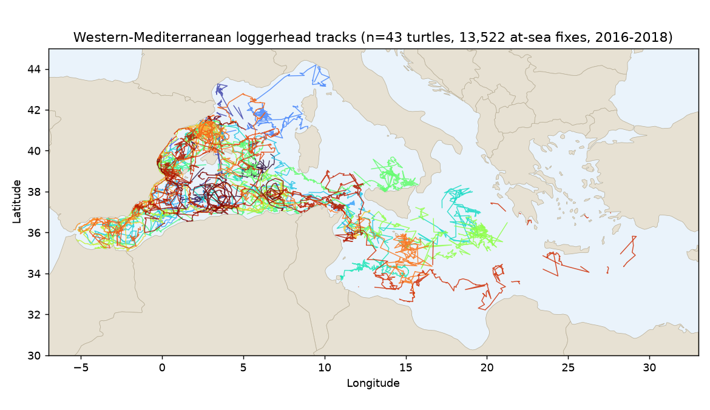

# Loggerhead Sea Turtle Tracking — Western & Central Mediterranean

End-to-end analysis of satellite-tracked loggerhead turtles (*Caretta caretta*): pull the raw fixes from OBIS, quality-filter them, map where the turtles aggregate and whose waters they cross, and ship it as figures, a report, and an interactive story map.



## Why this exists

Built as the evidence base for a marine protected-area and cross-border cooperation proposal. The Mediterranean is a semi-enclosed sea, so the conservation problem isn't the high seas — it's getting neighboring countries' EEZs to coordinate.

## Key findings

- **13,522 quality fixes** (56.2% of raw) across **43 individuals**, after dropping Argos-Z, on-land, and implausible-speed points.
- Turtles used **10 national EEZs** — Spain, Algeria, Italy, Tunisia, Libya, Greece, Malta, Morocco, France, Turkey.
- **Median 3 countries per turtle, up to 8** (one individual crossed eight, reaching Turkey).
- Track length: **median 2,827 km, max 16,658 km**.
- **97.8% of fixes in 18–26 °C** surface water (median 19.7 °C) — a strong thermal preference.
- **0% high-seas (ABNJ) use** — the entire challenge is EEZ-to-EEZ coordination.

> EEZ here is a "nearest country ≤ 200 nm" proxy, not an official maritime boundary. Use Marine Regions' official EEZs for precise work.

## What's in here

| File | What it is |
|------|-----------|
| `turtle_storymap.html` | Interactive Leaflet story map — opens offline, per-turtle animation, SST-colored trails, border-crossing view |
| `fig_*.png` | Tracks, aggregation hotspots, EEZ use, SST distribution, countries per turtle |
| `*.docx` | Analysis report and MPA cooperation proposal |

## Reproduce

```bash
python3 download_obis.py   # 24,125 fixes from OBIS  -> loggerhead_clean.csv
python3 analyze.py         # QC + EEZ + stats        -> loggerhead_filtered.csv, per_individual.csv, hotspots.csv, findings.json
python3 plots.py           # figures                 -> fig_*.png
python3 build_webdata.py   # story-map payload       -> webdata.json
```

Dependencies: `numpy pandas matplotlib scipy shapely pyproj requests scikit-learn` (Python), `docx` (Node). Spatial analysis uses Natural Earth 50m country/coastline GeoJSON (`ne_50m_*.geojson`, public domain).

## Data & license

- **Tracks** — [OBIS](https://obis.org) dataset `e69a5cc7-2c7d-4ef7-8662-a68a326bddad`, *"Satellite-tracking of loggerhead sea turtles tracked from western Mediterranean"* (24,125 raw fixes, 44 individuals, 2016–2018). **CC0.**
- **Borders & coastline** — [Natural Earth](https://www.naturalearthdata.com) (public domain).
- **Map rendering** — [Leaflet](https://leafletjs.com) (BSD-2-Clause, inlined).

Analysis code and documents © the author.
